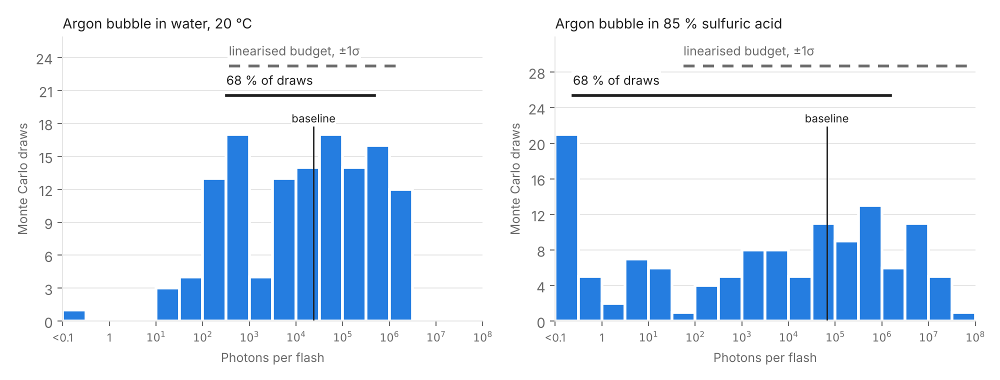

# Can the brightness of single-bubble sonoluminescence test a model? A Monte Carlo uncertainty budget

**DRAFT, not reviewed. Authorship to be confirmed.**
Anton Krugovov (slovo-lab); analysis, code and text prepared with Claude, an AI model by Anthropic (see *AI disclosure*).

## Abstract

Models of single-bubble sonoluminescence (SBSL) are routinely judged by whether they reproduce the measured number of photons per flash. We ask how much that comparison can discriminate, given how well the inputs of such a model are known. Using an open, radially resolved model of an argon bubble (wall dynamics, heat and vapour transport, post-hoc chemistry, ionisation and continuum emission), we compute sensitivity coefficients for twelve inputs and propagate assumed input uncertainties both linearly (JCGM 100) and by Monte Carlo (JCGM 101). For an argon bubble in water at 20 °C the light output scales as the 25th power of the acoustic drive pressure, and for the published dim argon bubble in 85% sulfuric acid as the 68th power. With a drive-pressure uncertainty of 4% (water) and 10% (acid), the Monte Carlo 68% interval of the photon number spans a factor of about 1,500 in water and is unbounded below in acid, where 38% of draws give essentially no light. In water the dominant term is not the drive but the rate at which vapour leaves the bubble, on which published simulations differ by a factor of two [5, 14]. Mean and median photon numbers differ by factors of 13 (water) and 210 (acid). Brightness can therefore test a model only if the drive pressure at the bubble is known to 1–3% and, in water, the trapped vapour is fixed independently.

## 1. Introduction

The mechanical part of SBSL — the bubble radius as a function of time — is reproduced well by Rayleigh–Plesset-type models. The light is harder. Whether a model "explains" the emission is usually decided by comparing its photon number per flash, flash width and spectrum with measurements [1]. Two facts make that comparison delicate. First, neither the ambient bubble radius nor the drive pressure at the bubble is known a priori; both are fitted to radius–time curves, and the fitted values depend on the model, while hydrophone measurements of the drive are limited to roughly 0.05 bar [1]. Second, the emission depends steeply on the collapse temperature. The steepness is widely acknowledged; we have not found a quantitative budget that states, input by input, how far the predicted brightness is uncertain because of it.

This note provides such a budget for one open model and two reference cases, and states the measurement accuracy that would make brightness a discriminating test.

## 2. Model

The model is open source (see *Code and data*); we summarise it.

- **Wall.** Keller–Miksis equation with liquid compressibility, viscosity and surface tension.
- **Interior.** Uniform pressure (low-Mach approximation); temperature and vapour mole fraction resolved along the radius on a 40-node grid clustered at the wall; heat conduction, vapour diffusion, interdiffusion enthalpy flux and Stefan flow at the wall; van der Waals co-volume. The pressure follows from exact conservation of argon; vapour is carried in conservative finite-volume form. Checks: argon conserved to 10⁻¹⁴, vapour content against wall flux to the time-integration tolerance, local argon balance converging at first order with the grid.
- **Chemistry and ionisation.** Post-hoc in each shell at fixed volume and energy: equilibrium H₂O ⇌ 2H + O, Saha ionisation of Ar, H and O with a density-dependent lowering of the ionisation potential (neutral-gas polarisation scaled from liquid argon plus Stewart–Pyatt screening [12]).
- **Emission.** Kramers–Unsöld continuum of Ar, H and O and electron–neutral bremsstrahlung (argon momentum-transfer cross-section for all neutrals), traced along rays through the shells.

**Reference cases.** (W) argon in water at 20 °C, ambient radius 4.5 µm, 26.5 kHz, drive 1.35 atm. (A) the dim argon bubble in 85% sulfuric acid of Flannigan et al. [8]: ambient radius 13 µm, effective drive 1.4 bar, 30 kHz assumed (the frequency is not reported).

**Validation without fitting (case A).** With only the liquid properties changed, the model gives a collapse radius of 2.95 µm (measured 3.1 µm), a central argon density of 1.18 × 10²¹ cm⁻³ (1.0–1.2 × 10²¹), a central temperature of 12,100 K (10,000 K) and a pressure of 2,170 bar (1,100–1,600 bar) [8]. Argon bubbles in sulfuric acid have been simulated before, with similar agreement [10, 13]. For water at 20 °C the model's peak optical power is 57–440 times below a measured order of 10 mW; adding radiative attachment of electrons to H and O, known to matter in water [6, 7], reduces this to 23–130 times. The budget below uses the model without attachment, which raises the light about threefold in water and leaves acid unchanged.

## 3. Method

**Inputs and assumed uncertainties** (relative standard uncertainties; full list and reasons in `budget.py`):

| Input | Water | Acid | Basis |
|---|---|---|---|
| Drive pressure | 4% | 10% | hydrophone ~0.05 bar [1]; fit tolerance [9] |
| Ambient radius | 5% | 5% | assumed |
| Frequency | 0.1% | 30–37.8 kHz, uniform | electronic; not reported |
| Vapour pressure | 6% | 50% | liquid temperature to 1 K; assumed |
| Viscosity | 2.5% | 20% | liquid temperature; concentration |
| Surface tension, density, sound speed | 2%, 0.1%, 0.5% | same | assumed |
| Vapour diffusivity | factor 2, log-uniform | same | published trapped-vapour fractions differ twofold [5, 14] |
| Gas thermal conductivity | 20% | 20% | dense-gas corrections |
| Co-volume | 10% | 10% | assumed |
| Electron–neutral cross-section | 30% | 30% | approximate table |

**Linear budget.** Sensitivity coefficients c = ∂ln(output)/∂ln(input) by central differences over ±5%, combined in quadrature (JCGM 100 [11]).

**Monte Carlo.** All twelve inputs drawn together (log-normal factors, the two uniform inputs as stated), 128 Latin-hypercube draws per case, full model per draw, one acoustic cycle per run (JCGM 101 [11]). One cycle differs from two by 0.4% in water and 19% in acid, small next to the spreads found.

## 4. Results

**Sensitivity.** The photon number goes as the 25th power of the drive pressure in water and the 68th power in acid. In water the next coefficients are vapour diffusivity (+9.6), vapour pressure (−7.5) and gas thermal conductivity (−6.1); in acid, frequency (−15) and viscosity (−8.5). The collapse radius has coefficients of order 1 for every input, which is why mechanics agree with experiment at the 5% level while brightness does not.

**Non-linearity.** In water a 10% lower drive gives 170 times less light and a 10% higher drive only 4 times more, because a harder collapse traps more vapour. In acid the same steps give 36,000 times less and 79 times more.

**Monte Carlo (Fig. 1, Table 1).**

| | Water | Acid |
|---|---|---|
| Median photons per flash | 2.0 × 10⁴ | 8.5 × 10³ |
| 68% interval | 3.2 × 10² to 4.8 × 10⁵ | 0.2 to 1.5 × 10⁶ |
| 95% interval | 23 to 1.7 × 10⁶ | 0 to 1.5 × 10⁷ |
| 68% interval relative to the median, below / above | 62 / 24 | 35,000 / 180 |
| Linear budget, each way | 65 | 1,200 |
| Mean / median | 13 | 210 |
| Draws with < 1% of the baseline light | 12% | 38% |
| Central temperature, 95% interval | 7,600–18,900 K | 2,900–17,600 K |
| Largest rank correlation with ln(photons) | vapour diffusivity, +0.90 | drive pressure, +0.94 |

*Figure 1. Photons per flash in 128 Monte Carlo draws for each case. Black bar: interval containing 68% of draws. Dashed: ±1σ of the linearised budget. Draws below 0.1 photons are collected at the left.*

- **Water.** The linear budget is about right on the low side and too wide on the high side. The spread is set mainly by the vapour diffusivity, a model parameter, not by the drive.
- **Acid.** The distribution has a threshold rather than a spread: within the stated 10% drive tolerance the dim bubble may give no measurable light at all. The linear budget is wrong in kind.
- **Mean versus median.** Because the response is convex, rare hot collapses dominate averages. A model's typical flash compared with a measured average brightness is biased upward by factors of order 10 (water) to 100 (acid).

## 5. Discussion

The drive accuracy that keeps the pressure term of the linear budget below a factor of two is 2.8% in water and 1.0% in acid. Current practice quotes about 4% (hydrophone) and 10% (fit tolerance). In water, even an exact drive leaves a factor of about 58 from the remaining inputs, almost all of it from vapour transport.

Two practical suggestions follow. Comparisons of model and measured brightness should state the drive-pressure uncertainty and propagate it, preferably by sampling. And experiments that fix the bubble's ambient radius and drive pressure independently of any bubble model — together with the trapped vapour in water — would turn brightness into a test that can tell models apart.

**Limitations.** One model; the input uncertainties are assumptions, listed so that they can be replaced; 128 draws fix the 95% bounds to within about a factor of two (bootstrap); radiative attachment was not included in the sampled model; chemistry and ionisation are post-hoc; the electron–neutral cross-section of argon stands in for all neutrals. The qualitative point — strong sensitivity to the drive — is in the literature [1]; what we add is the numbers, the non-linear shape, and the measurement accuracy that would be needed.

## Code and data

https://github.com/slovo-lab/sonoluminescence — `profile.py` (model), `budget.py` (linear budget), `mc_budget.py` (Monte Carlo), `conservation_check.py`, result files `results_budget.txt`, `results_mc.txt`, `mc.json`.

## AI disclosure

The model, the calculations and the text of this draft were produced by Claude (Anthropic), an AI system, under the supervision of the human author, who takes responsibility for the work. Errors found during the work, including two conservation errors in the model, are documented in the repository history.

## References

1. M. P. Brenner, S. Hilgenfeldt, D. Lohse, Rev. Mod. Phys. 74, 425 (2002).
2. J. B. Keller, M. Miksis, J. Acoust. Soc. Am. 68, 628 (1980).
3. S. Hilgenfeldt, S. Grossmann, D. Lohse, Nature 398, 402 (1999).
4. R. Toegel, B. Gompf, R. Pecha, D. Lohse, Phys. Rev. Lett. 85, 3165 (2000).
5. B. D. Storey, A. J. Szeri, Proc. R. Soc. Lond. A 456, 1685 (2000).
6. D. Hammer, L. Frommhold, Phys. Rev. E 65, 046309 (2002).
7. Y. An, Phys. Rev. E 74, 026304 (2006).
8. D. J. Flannigan, S. D. Hopkins, C. G. Camara, S. J. Putterman, K. S. Suslick, Phys. Rev. Lett. 96, 204301 (2006).
9. S. D. Hopkins, S. J. Putterman, B. A. Kappus, K. S. Suslick, C. G. Camara, Phys. Rev. Lett. 95, 254301 (2005).
10. A. Moshaii, Kh. Imani, M. Silatani, Phys. Rev. E 80, 046325 (2009).
11. JCGM 100:2008 (GUM); JCGM 101:2008 (Supplement 1, Monte Carlo).
12. J. C. Stewart, K. D. Pyatt, Astrophys. J. 144, 1203 (1966).
13. K. Y. Kim, K.-T. Byun, H.-Y. Kwak, "Characteristics of sonoluminescing bubbles in aqueous solutions of sulfuric acid" (journal and year to be completed).
14. L. Yuan et al., "Sonochemical effects on single-bubble sonoluminescence", arXiv:physics/0501041.
