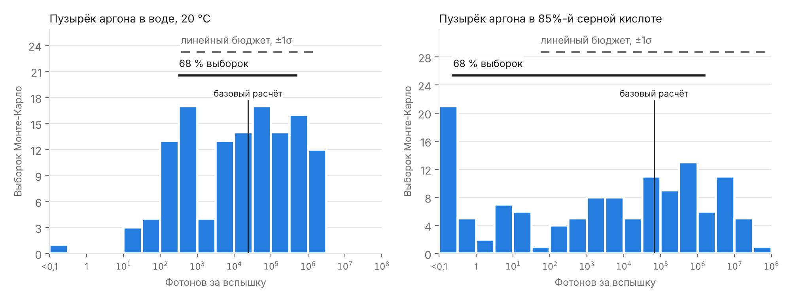

# Может ли яркость однопузырьковой сонолюминесценции проверить модель? Бюджет неопределённости методом Монте-Карло

**ЧЕРНОВИК, не рецензирован. Авторство подлежит подтверждению.**
Антон Круговов (slovo-lab); расчёты, код и текст подготовлены с помощью Claude, ИИ-модели компании Anthropic (см. *Раскрытие использования ИИ*).

*Перевод английской версии `preprint.en.md`; при расхождениях основной считается английская.*

## Аннотация

Модели однопузырьковой сонолюминесценции обычно оценивают по тому, воспроизводят ли они измеренное число фотонов за вспышку. Мы спрашиваем, насколько такое сравнение вообще способно различать модели, если учесть, насколько хорошо известны входные данные. На открытой модели пузырька аргона с разрешением по радиусу (движение стенки, перенос тепла и пара, химия и ионизация после расчёта, непрерывное излучение) мы вычисляем коэффициенты чувствительности для двенадцати входов и распространяем принятые неопределённости входов линейно (JCGM 100) и методом Монте-Карло (JCGM 101). Для пузырька аргона в воде при 20 °C световой выход растёт как 25-я степень давления акустической накачки, а для опубликованного тусклого пузырька аргона в 85%-й серной кислоте — как 68-я степень. При неопределённости давления накачки 4% (вода) и 10% (кислота) интервал 68% по методу Монте-Карло охватывает в воде множитель около 1 500, а в кислоте не ограничен снизу: в 38% выборок света практически нет. В воде главный вклад даёт не накачка, а скорость, с которой пар покидает пузырёк; по ней опубликованные расчёты расходятся вдвое. Среднее и медиана числа фотонов различаются в 13 раз (вода) и в 210 раз (кислота). Поэтому яркость может проверить модель, только если давление накачки у пузырька известно с точностью 1–3%, а в воде ещё и количество запертого пара определено независимо.

## 1. Введение

Механическую часть сонолюминесценции, то есть радиус пузырька как функцию времени, модели типа Рэлея–Плессета воспроизводят хорошо. Со светом сложнее. «Объясняет» ли модель свечение, обычно решают, сравнивая её число фотонов за вспышку, длительность вспышки и спектр с измерениями [1]. Два обстоятельства делают это сравнение ненадёжным. Во-первых, ни радиус покоя пузырька, ни давление накачки у пузырька заранее не известны: оба подгоняются по кривым радиус–время, подогнанные значения зависят от модели, а точность гидрофона ограничена примерно 0,05 бар [1]. Во-вторых, свечение круто зависит от температуры при схлопывании. Эта крутизна общепризнана, но количественного бюджета, который по каждому входу показывал бы, насколько из-за неё неопределённа предсказанная яркость, мы не нашли.

В этой заметке такой бюджет построен для одной открытой модели и двух опорных случаев, и указана точность измерений, при которой яркость стала бы проверкой, различающей модели.

## 2. Модель

Модель открыта (см. *Код и данные*); кратко:

- **Стенка.** Уравнение Келлера–Миксиса со сжимаемостью, вязкостью и поверхностным натяжением жидкости.
- **Внутренность пузырька.** Однородное давление (приближение малых чисел Маха); температура и мольная доля пара меняются по радиусу на сетке из 40 узлов, сгущённой у стенки; теплопроводность, диффузия пара, перенос энтальпии взаимной диффузией и стефановский поток у стенки; коволюм Ван-дер-Ваальса. Давление находится из точного сохранения числа атомов аргона; пар переносится в консервативной конечно-объёмной форме. Проверки: аргон сохраняется до 10⁻¹⁴, изменение количества пара совпадает с потоком через стенку до точности интегрирования, локальный баланс аргона сходится с первым порядком по сетке.
- **Химия и ионизация.** После расчёта, в каждом слое при фиксированных объёме и энергии: равновесие H₂O ⇌ 2H + O, ионизация Ar, H и O по Саха со снижением потенциала ионизации, зависящим от плотности (поляризация нейтрального газа по данным для жидкого аргона плюс экранирование по Стюарту–Пайатту [12]).
- **Излучение.** Непрерывный спектр Крамерса–Унзольда для Ar, H и O и тормозное излучение на нейтральных атомах (сечение передачи импульса аргона для всех нейтральных частиц), просчитанное вдоль лучей сквозь слои.

**Опорные случаи.** (В) аргон в воде при 20 °C, радиус покоя 4,5 мкм, 26,5 кГц, накачка 1,35 атм. (К) тусклый пузырёк аргона в 85%-й серной кислоте из работы Flannigan и соавторов [8]: радиус покоя 13 мкм, эффективная накачка 1,4 бар, частота 30 кГц принята (в статье не указана).

**Проверка без подгонки (случай К).** При изменении только свойств жидкости модель даёт радиус схлопывания 2,95 мкм (измерено 3,1 мкм), плотность аргона в центре 1,18 × 10²¹ см⁻³ (1,0–1,2 × 10²¹), температуру в центре 12 100 K (10 000 K) и давление 2 170 бар (1 100–1 600 бар) [8]. Пузырьки аргона в серной кислоте уже моделировались, с похожим согласием [10, 13]. Для воды при 20 °C пиковая мощность света в модели в 57–440 раз ниже измеренных «порядка 10 мВт»; учёт прилипания электронов к атомам H и O, важного в воде [6, 7], сокращает разрыв до 23–130 раз. Бюджет ниже построен для модели без прилипания: прилипание увеличивает свет в воде примерно втрое и не меняет результат для кислоты.

## 3. Метод

**Входы и принятые неопределённости** (относительные стандартные неопределённости; полный список с обоснованиями в `budget.py`):

| Вход | Вода | Кислота | Обоснование |
|---|---|---|---|
| Давление накачки | 4% | 10% | гидрофон около 0,05 бар [1]; допуск подгонки [9] |
| Радиус покоя | 5% | 5% | принято |
| Частота | 0,1% | 30–37,8 кГц, равномерно | электроника; не указана |
| Давление пара | 6% | 50% | температура жидкости до 1 K; принято |
| Вязкость | 2,5% | 20% | температура жидкости; концентрация |
| Поверхностное натяжение, плотность, скорость звука | 2%, 0,1%, 0,5% | так же | принято |
| Коэффициент диффузии пара | в 2 раза, логарифмически равномерно | так же | опубликованные доли запертого пара расходятся вдвое [5, 14] |
| Теплопроводность газа | 20% | 20% | поправки для плотного газа |
| Коволюм | 10% | 10% | принято |
| Сечение электрон–атом | 30% | 30% | приближённая таблица |

**Линейный бюджет.** Коэффициенты чувствительности c = ∂ln(выход)/∂ln(вход) центральными разностями на ±5%, сложение квадратичное (JCGM 100 [11]).

**Монте-Карло.** Все двенадцать входов разыгрываются одновременно (логнормальные множители, два равномерных входа как указано), 128 выборок латинского гиперкуба на случай, полная модель на каждую выборку, один цикл звука на расчёт (JCGM 101 [11]). Один цикл отличается от двух на 0,4% в воде и на 19% в кислоте, что мало по сравнению с найденным разбросом.

## 4. Результаты

**Чувствительность.** Число фотонов растёт как 25-я степень давления накачки в воде и как 68-я в кислоте. В воде следующие коэффициенты дают коэффициент диффузии пара (+9,6), давление пара (−7,5) и теплопроводность газа (−6,1); в кислоте — частота (−15) и вязкость (−8,5). У радиуса схлопывания коэффициенты порядка 1 по всем входам, поэтому механика сходится с опытом на уровне 5%, а яркость нет.

**Нелинейность.** В воде накачка на 10% ниже даёт в 170 раз меньше света, а на 10% выше — только в 4 раза больше: при более жёстком схлопывании запирается больше пара. В кислоте те же шаги дают в 36 000 раз меньше и в 79 раз больше.

**Монте-Карло (рис. 1, табл. 1).**

| | Вода | Кислота |
|---|---|---|
| Медиана числа фотонов за вспышку | 2,0 × 10⁴ | 8,5 × 10³ |
| Интервал 68% | от 3,2 × 10² до 4,8 × 10⁵ | от 0,2 до 1,5 × 10⁶ |
| Интервал 95% | от 23 до 1,7 × 10⁶ | от 0 до 1,5 × 10⁷ |
| Интервал 68% относительно медианы, вниз / вверх | 62 / 24 | 35 000 / 180 |
| Линейный бюджет, в каждую сторону | 65 | 1 200 |
| Среднее / медиана | 13 | 210 |
| Выборок со светом < 1% от базового | 12% | 38% |
| Температура в центре, интервал 95% | 7 600–18 900 K | 2 900–17 600 K |
| Наибольшая ранговая корреляция с ln(фотонов) | диффузия пара, +0,90 | давление накачки, +0,94 |

*Рисунок 1. Число фотонов за вспышку в 128 выборках Монте-Карло для каждого случая. Чёрная полоса: интервал, в который попадают 68% выборок. Пунктир: ±1σ линейного бюджета. Выборки с числом фотонов меньше 0,1 собраны слева.*

- **Вода.** Линейный бюджет примерно верен вниз и слишком широк вверх. Разброс в основном задаёт коэффициент диффузии пара, параметр модели, а не накачка.
- **Кислота.** У распределения порог, а не разброс: в пределах заявленного допуска накачки 10% тусклый пузырёк может не давать измеримого света вовсе. Линейный бюджет ошибается по сути.
- **Среднее и медиана.** Поскольку отклик выпуклый, средние определяются редкими горячими схлопываниями. Сравнение типичной вспышки модели со средней измеренной яркостью смещено вверх на множитель порядка 10 (вода) – 100 (кислота).

## 5. Обсуждение

Точность накачки, при которой её вклад в линейный бюджет меньше множителя 2, составляет 2,8% в воде и 1,0% в кислоте. На практике называют около 4% (гидрофон) и 10% (допуск подгонки). В воде даже при точно известной накачке остальные входы оставляют множитель около 58, почти целиком из-за переноса пара.

Отсюда два практических предложения. Сравнения яркости модели и опыта должны указывать неопределённость давления накачки и распространять её, лучше выборками. А опыты, в которых радиус покоя пузырька и давление накачки определяются независимо от какой-либо модели пузырька — а в воде ещё и количество запертого пара, — превратили бы яркость в проверку, способную различать модели.

**Ограничения.** Одна модель; неопределённости входов приняты и перечислены, чтобы их можно было заменить; 128 выборок определяют границы интервала 95% примерно с точностью до двух раз (бутстреп); прилипание электронов в модель для выборок не включено; химия и ионизация считаются после расчёта; сечение аргона используется для всех нейтральных частиц. Качественный тезис — сильная чувствительность к накачке — в литературе есть [1]; мы добавляем числа, нелинейную форму отклика и требуемую точность измерений.

## Код и данные

https://github.com/slovo-lab/sonoluminescence — `profile.py` (модель), `budget.py` (линейный бюджет), `mc_budget.py` (Монте-Карло), `conservation_check.py`, файлы результатов `results_budget.txt`, `results_mc.txt`, `mc.json`.

## Раскрытие использования ИИ

Модель, расчёты и текст этого черновика подготовлены Claude (Anthropic), системой искусственного интеллекта, под руководством автора-человека, который несёт ответственность за работу. Ошибки, найденные по ходу работы, в том числе две ошибки сохранения массы в модели, описаны в истории репозитория.

## Литература

См. английскую версию: список общий.
